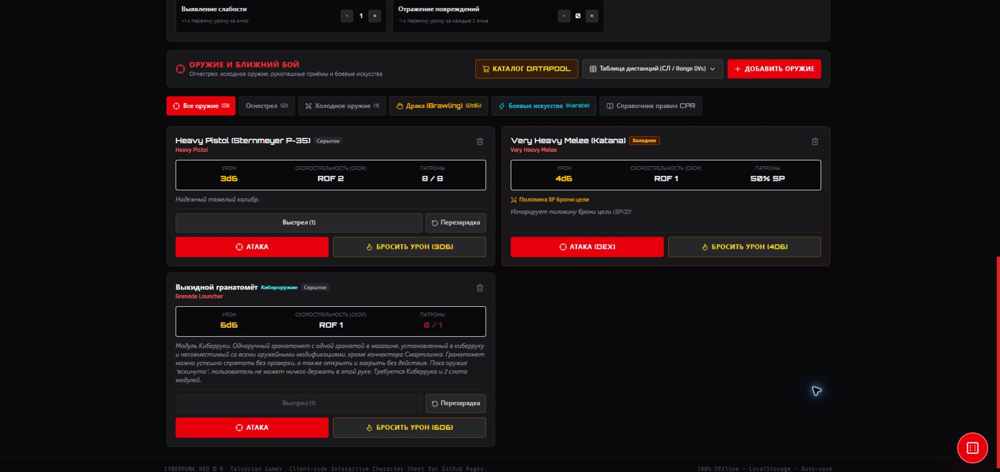

# Киберимпланты, слоты и оружие — 25.10.2026

Все 173 записи [страницы имплантов Data Pool](https://alec-leon.github.io/data-pool/chrome/implants/) получили метаданные установки: 155 имплантов, 9 щепок и 9 улучшений. Имена уже присутствовали в прежнем каталоге; этот выпуск добавляет структуру и поведение. Сохранены прежние идентификаторы `cat-cyber-1`…`cat-cyber-173`, описания и ссылки на источник. Исправлен разбор последних девяти улучшений EMK: раньше их описание, цена и место установки попадали в неверные поля.

## Использование

1. Купите имплант в магазине: он попадёт в инвентарь без потери Humanity. Ручное добавление также создаёт запись инвентаря.
2. Нажмите «Установить» и выберите конкретное основание или часть тела. Система проверяет тип основания, свободные слоты, поддержанные требования и взаимоисключения.
3. Подтвердите установку: списывается указанная потеря Humanity. Стоимость операции в клинике и неизвестные значения проверяйте по описанию.
4. Используйте «Снять в инвентарь», чтобы освободить слоты. Зависимые опции также снимаются, оставаясь собственностью персонажа. Текущая Humanity при снятии автоматически не восстанавливается.

Устанавливаются отдельные левая/правая конечности и глаза, нейро- и аудиооснования. Основания предоставляют собственные пулы опций; например, киберрука — 4, кибернога и киберглаз — по 3, нейролинк — 5. Комплектные ноги имеют два отдельных пула. Поддержаны дополнительные крепления Smartlink/MicroWaldo, парные опции на разных основаниях, киберпальцы и специальные основания улучшений EMK. Опция для органической руки исключает установку киберруки в то же место.

## Оружие

Каталог содержит 27 базовых боевых представлений имплантов и одно улучшение оружия Gorilla. Установленное кибероружие автоматически появляется с меткой «Кибероружие». Его нельзя удалить отдельно от импланта. Снятие основания убирает связанные боевые представления; повторная установка сохраняет оставшиеся патроны и выбранный профиль. Снятие улучшения убирает его бонусы.

Универсальные выкидные крепления требуют выбрать уже имеющееся подходящее одноручное оружие. Оно переносится без дублирования и возвращается при снятии с исходным идентификатором и текущими магазинами. Выбор ограничен поддержанными категориями пистолетов/SMG и лёгкого/среднего/тяжёлого холодного оружия; нестандартные экзотические варианты требуют ручной проверки. Эффекты без броска атаки или обычного урона не получают выдуманного броска.

## Совместимость сохранений

Старые импланты без размещения не переставляются автоматически: сохраняется прежнее поведение и выводится предупреждение. Назначьте им слоты через «Размещение / оружие»; повторная Humanity при переназначении уже установленного импланта не списывается. Новые персонажи получают размещённый начальный набор.

Пользовательские поля и настройки сохраняются. Потерявшее владельца оружие сохраняется с предупреждением и возможностью удаления, чтобы повреждённая связь не уничтожала пользовательский предмет. Снятые импланты не дают поддержанных пассивных эффектов, не повышают BODY и не участвуют в абляции подкожной брони.

## Проверки

- 73 регрессионных теста, включая 22 новых проверки каталога, установки, переполнения, совместимости, парности, каскадного снятия, Humanity, оружия, сохранений и некорректных импортов.
- Проверка воспроизводимости обоих импортёров и production-сборка TypeScript/Vite.
- Отдельный браузерный origin: киберрука → гранатомёт на 2/4 слота → выстрел → снятие основания и опций → повторная установка. После повторного открытия страницы гранатомёт остаётся с 0/1 патронов; ошибок и предупреждений консоли не обнаружено.

## Границы автоматизации

Data Pool — вторичный источник. Наличие всех записей этой страницы не доказывает полноту всех DLC и не заменяет первоисточники RTG.

У девяти улучшений EMK страница не указывает HL и не задаёт полную модель числа/совместимости улучшений. Значение HL помечено неизвестным; специальное крепление с нулевой стоимостью слотов — техническое размещение, а не утверждение о неограниченной установке по правилам. Сверяйте условия с EMK. Проверки полной конверсии тела (FBC), часть ситуативных эффектов и парных бонусов Gorilla/Mantis/Sparkle, варианты цены щепок и специальные боевые действия остаются ручными. Система Quickhacks не реализована.

Воспроизведение каталога: сохраните исходную страницу в игнорируемый `audit/source/implants.html` и выполните `python scripts/import-cyberware.py --check`. Исходный HTML и книги в репозиторий не публикуются.
