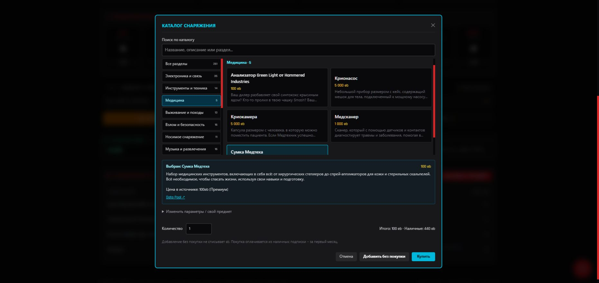

# Каталог снаряжения — 25.10.2026

В разделе «Снаряжение и деньги» кнопка «Добавить предмет» открывает каталог карточек с разделами, поиском и полными описаниями. Дублирующая кнопка «Каталог DataPool» убрана. В карточках показана цена; выбранный предмет открывает описание и ссылку на источник. Ручное создание и изменение предмета остаются в раскрывающемся блоке.

Каталоги снаряжения и имплантов используют общий компонент навигации, поиска и карточек. В глобальном магазине также доступны фильтры снаряжения по тем же разделам.

## Состав и источник

Из [Data Pool Equipment](https://alec-leon.github.io/data-pool/equipment/) импортировано 261 предложение в 14 разделах:

| Источник | Предложения |
| --- | ---: |
| [Предметы и расходники](https://alec-leon.github.io/data-pool/equipment/items/) | 132 |
| [Одежда и стиль](https://alec-leon.github.io/data-pool/equipment/clothes_style/) | 90 |
| [Агенты и аксессуары](https://alec-leon.github.io/data-pool/equipment/agents_accessories/) | 10 |
| [Софт для агента](https://alec-leon.github.io/data-pool/equipment/soft/) | 20 |
| [Компоненты силовой брони с указанной ценой](https://alec-leon.github.io/data-pool/equipment/acpa/) | 9 |

На странице предметов 126 исходных строк. Варианты агента и униформы представлены отдельно: по четыре цены вместо одной, поэтому получается 132 предложения. Для одежды созданы девять типов предметов в каждом из десяти стилей. Таблицы причёсок, стиля 2070-х и непрайсовые варианты сборки силовой брони не превращаются в выдуманные бесплатные товары. Оружие и обычная броня используют существующие отдельные каталоги.

Навигационные разделы: электроника и связь; инструменты и техника; медицина; выживание и походы; взлом и безопасность; носимое снаряжение; музыка и развлечения; бытовые предметы; еда и напитки; расходники; одежда; агенты и аксессуары; софт; компоненты силовой брони. Это группировка интерфейса, она не назначает автоматических механических эффектов.

## Добавление и покупка

Выберите карточку и количество от 1 до 999. «Добавить без покупки» вносит уже имеющееся снаряжение без списания денег. «Купить» списывает цену × количество из наличных и отказывает при нехватке денег. Бесплатный софт сохраняет нулевую цену. Две подписки помечены «/ мес.»; покупка оплачивает первый месяц, последующие платежи автоматически не списываются.

Одинаковые предложения каталога с неизменёнными свойствами складываются в одну строку. Старые записи, пользовательские правки и неизвестные поля сохраняются. Совпадение одного имени не объединяет разные записи. Сохранены все прежние идентификаторы `cat-gear-1`…`cat-gear-126`; уже созданные предметы не переписываются новым каталогом. Полные длинные описания в инвентаре раскрываются, чтобы не растягивать таблицу.

Агенты-импланты в этом каталоге — записи инвентаря; установка, HL и слоты требуют отдельного учёта. Компоненты силовой брони не включают автоматизацию её сборки и боевых эффектов. Покупка обычного снаряжения не активирует описанные бонусы автоматически. Data Pool — вторичный источник; полнота всех книг и DLC этим выпуском не заявляется.

## Проверка и воспроизведение

83 теста прошли: доступность каталога и разделов, передача исходных данных из карточки, варианты цен, бесплатный софт и подписки, количество и нехватка денег, сохранение старых/изменённых записей, сохранение и загрузка. Существующие проверки киберимплантов проходят после выделения общего компонента.

Браузерный прогон на отдельном локальном origin: тематический раздел → поиск фонарика → покупка трёх штук по 20 eb → наличные 500 → 440 eb → перезагрузка → сохранены количество 3 и сумма 440 eb. Проверена ширина 390 px: разделы прокручиваются горизонтально, карточки идут в одну колонку, действия доступны при прокрутке окна. Проверены полное описание и выбор медицинского снаряжения. Ошибок и предупреждений консоли нет.

Для воспроизведения сохраните пять страниц в `audit/source/gear-{items,clothes,agents,soft,acpa}.html` и запустите `python scripts/import-gear.py --check`. Скрипт использует стандартную библиотеку Python, не исполняет код страниц, сохраняет существующие идентификаторы и проверяет их уникальность. Исходный HTML игнорируется Git; в генерируемом каталоге сохранены хеши исходников.
