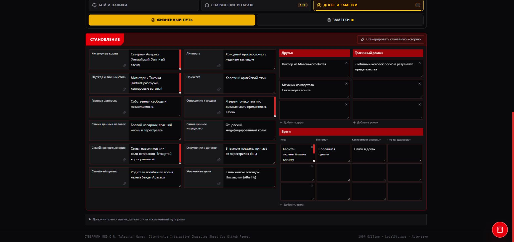

# Становление и жизненный путь — 25.10.2026

Компоновка раздела приведена к присланному образцу листа персонажа. Значения из изображения не переносятся в данные или значения по умолчанию. Цвета и поля поддерживают текущую тему приложения.

Основная сетка содержит шесть рядов по две пары «название — значение»:

| Левая пара | Правая пара |
| --- | --- |
| Культурные корни | Личность |
| Одежда и личный стиль | Причёска |
| Главная ценность | Отношение к людям |
| Самый ценный человек | Самое ценное имущество |
| Семейная предыстория | Окружение в детстве |
| Семейный кризис | Жизненные цели |

Справа находятся «Друзья» и «Трагичный роман», по три начальные строки, а ниже — таблица «Враги»: «Кто?», «Почему?», «Какие имеет ресурсы?», «Что ты сделаешь?». Для отношений можно добавлять и удалять строки. Длинные списки не обрезаются до трёх; лимит импорта и добавления — 100 записей каждого вида.

Языки, детали личного стиля и заметки жизненного пути роли доступны в дополнительном раскрывающемся блоке. Они продолжают храниться в персонаже. Случайный выбор отдельных полей и генерация истории сохранены на прежних справочниках; культурные корни при отдельном броске обновляются вместе с описанием языков.

Один редактор используется в листе персонажа и на шаге 5 конструктора. При завершении конструктора введённые причёска, семья, детство, ценности, отношения и заметки больше не заменяются скрытыми шаблонными значениями. Если языки не заполнены, сохраняется обычное описание культурного языка из конструктора; ранги навыков по-прежнему определяются отдельным полем культурного языка.

## Сохранения

Старые строковые `friends`, `tragicLoveAffairs` и `enemies` отображаются целиком в первой строке соответствующего блока. Описание врагов показывается в «Кто?» первой строки: программа не пытается угадать, как разбить свободный текст на колонки. Само открытие формы не изменяет сохранение.

При редактировании отношения сохраняются в необязательных `friendEntries`, `loveAffairEntries` и `enemyEntries`. Каждая запись врага содержит `who`, `why`, `resources`, `response`. Строковые поля обновляются как текстовое представление для совместимости. Если структурированные массивы присутствуют в импортируемом JSON, редактор использует их, включая явно пустые массивы. Неизвестные поля персонажа, жизненного пути и редактируемой записи врага сохраняются. Некорректные типы и чрезмерные массивы отклоняются проверкой импорта.

## Проверки

98 тестов прошли, включая 7 проверок новой формы: порядок 12 полей, пустые начальные строки, перенос старого многострочного текста без разбиения, независимое редактирование и удаление строк, случайный выбор, сохранение/загрузка, защита импорта и завершение настоящего конструктора без перезаписи заполненного пути.

Браузерный прогон на отдельном локальном origin: проверены все основные поля, две строки в заметке второго друга, отдельные причина и ресурсы врага, перезагрузка с сохранением этих значений и форма на шаге 5 конструктора. На ширине 390 px страница не имеет горизонтального переполнения, таблица врагов прокручивается внутри своего контейнера. Ошибок и предупреждений консоли нет.

