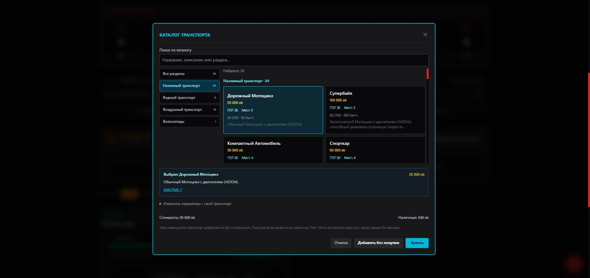

# Каталог транспорта — 25.10.2026

Кнопка «Добавить транспорт» открывает каталог в том же стиле, что снаряжение и импланты: разделы, поиск, карточки, полное описание выбранной модели и ссылка на источник. Дублирующий авторынок из панели гаража убран. В карточках указаны цена, ПЗТ, места, скорости и ранг Мото из таблицы. Ручная форма доступна в «Изменить параметры / свой транспорт».

## Данные

Источник: [гараж Data Pool](https://alec-leon.github.io/data-pool/workshop/garage/). Подтверждены 59 записей: 34 наземных, 8 водных, 16 воздушных моделей и базовый велосипед. Сохранены идентификаторы 58 исходных моделей и `veh-bike-1`. Полные описания, цены и многострочные режимы скорости берутся из сохранённой страницы; формулировки вроде «2 на комнату» не заменяются выдуманным числом мест.

Прежние пять вариантов велосипедов имели параметры и цены, не подтверждённые этой страницей. Они убраны из предложений каталога; уже сохранённые экземпляры не удаляются и не переписываются. Базовый велосипед теперь содержит все три диапазона скорости по BODY, включая BODY <4, и правила DLC из источника.

Роликовые коньки и скейтборды в разделе «Другие варианты» страницы относятся к носимому снаряжению и не включены в каталог машин с ПЗТ. Таблицы модернизаций не переимпортируются этим выпуском. Наличие модели и описания её комплектации не означает автоматическую установку всех перечисленных в описании модификаций.

## Добавление и покупка

«Добавить без покупки» вносит уже имеющийся транспорт без списания денег. «Купить» списывает цену из наличных персонажа; при нехватке денег выбор остаётся открытым. Каждая машина — отдельный экземпляр с уникальным ID и полной начальной прочностью. Одинаковые модели не объединяются, повреждения и улучшения существующих машин остаются нетронутыми.

Ранг Мото показан как информация о доступе через семью Кочевника и не блокирует обычную покупку за eb. Доступ через семью, ограничения велосипеда, ситуативные эффекты и комплектация требуют проверки по описанию и правилам. В сохранении остаются источник и идентификатор каталога. Длинные описания в карточках гаража прокручиваются.

Data Pool — вторичный источник. Выпуск добавляет каталог и обновляет подтверждённые данные транспорта; полнота автоматизации всех правил и DLC не заявляется.

## Проверка

91 тест, включая 8 проверок транспорта: категории и идентификаторы, поиск, полные данные выбранной модели, отдельные экземпляры, покупка и отказ при нехватке денег, ручные параметры, сохранение пользовательских полей, повреждений и улучшений. Глобальный магазин использует тот же путь создания транспорта.

Браузерный прогон на отдельном локальном origin: покупка велосипеда за 100 eb → наличные 440 → 340 eb → изменение прочности 15 → 10 ПЗТ → перезагрузка → сохранены 10/15 ПЗТ и 340 eb. Проверены выбор наземной модели, описание и ссылка на источник. На ширине 390 px окно не имеет горизонтального переполнения; разделы и карточки адаптируются, содержимое окна прокручивается. Ошибок и предупреждений консоли нет.

Для воспроизведения сохраните страницу в игнорируемый `audit/source/garage.html` и выполните `python scripts/import-vehicles.py --check`. Импортёр использует общий со снаряжением статический HTML-парсер на стандартной библиотеке Python; скрипты страницы не исполняются. В генерируемом файле сохранён SHA-256 исходного HTML. Проверки воспроизводимости остальных каталогов также проходят.
